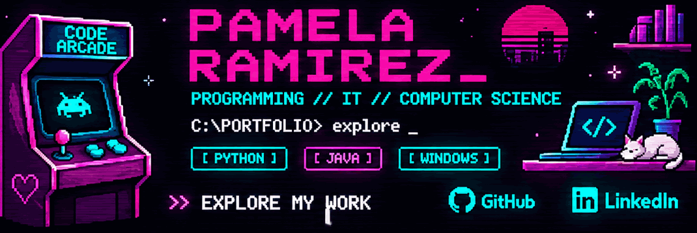
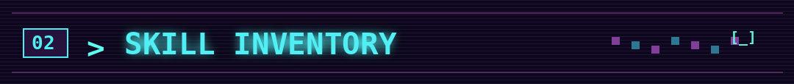

<div align="center">

# Pamela Ramirez





<br>

[](https://github.com/pramirez-tech)
[](https://www.linkedin.com/in/pamela-ramirez12)

`[ PLAYER: PAMELA RAMIREZ ]` · `[ COMPUTER SCIENCE ]` · `[ PROGRAMMING / IT ]`

</div>


```text
C:\PORTFOLIO> whoami
> Pamela Ramirez
> Computer Science Undergraduate | Programming | IT
```

I am pursuing a **Bachelor of Arts in Computer Science** at **Florida International University**, along with an **Undergraduate Certificate in Cybersecurity Intelligence and Information Policy**.

My background combines programming education, Python instruction, independent technical troubleshooting, and professional experience in behavioral services.

I'm developing my technical abilities through university education, independent learning, and practical problem-solving.

---



<div align="center">


</div>

| `MODULE` | `KNOWLEDGE / EXPERIENCE` |
|:--|:--|
| `01 // PROGRAMMING` | Java, Python |
| `02 // FUNDAMENTALS` | Variables, loops, conditionals, object-oriented programming |
| `03 // SYSTEMS` | Windows |
| `04 // TROUBLESHOOTING` | Problem investigation, technical research |
| `05 // COMMUNICATION` | Documentation, programming instruction |
| `06 // ANALYSIS` | Logical reasoning, problem-solving |

---


### `> QUEST_01: WINDOWS WI-FI CONNECTIVITY`

**Area:** IT Support & Technical Problem-Solving

Investigated and resolved a Windows 11 wireless connectivity issue through independent research and technical troubleshooting.

The investigation included examining the wireless adapter in Device Manager, troubleshooting drivers, performing a network reset, and researching possible causes.

The issue was ultimately resolved by identifying and re-enabling a disabled wireless network adapter through Windows Network Connections.

**Focus:**

`Windows 11` · `Technical Investigation` · `Network Troubleshooting` · `Independent Research`

**Resolution:**

```text
C:\WINDOWS\SYSTEM32> ncpa.cpl

[+] Network Connections opened
[+] Disabled Wi-Fi adapter identified
[+] Wireless adapter enabled
[✓] Wi-Fi connectivity restored
```

**QUEST STATUS:** `COMPLETED ✅`

<div align="center">

[](https://github.com/pramirez-tech/windows-wifi-troubleshooting)


[](https://github.com/pramirez-tech/windows-wifi-troubleshooting)


</div>

---


### `> EXPERIENCE: PYTHON PROGRAMMING INSTRUCTOR`

Taught introductory **Python** programming to students, supporting their understanding of coding fundamentals and computational thinking.

- Explained foundational programming concepts
- Guided students through coding exercises
- Supported debugging and problem-solving
- Adapted technical explanations to students' learning needs

---


### `> FLORIDA INTERNATIONAL UNIVERSITY`

**Bachelor of Arts in Computer Science**  
`STATUS: IN PROGRESS`

**Undergraduate Certificate in Cybersecurity Intelligence and Information Policy**  
`STATUS: IN PROGRESS`

### `> INDIAN RIVER STATE COLLEGE`

**Associate of Arts in Psychology**  
`STATUS: COMPLETED`

---


### `> REGISTERED BEHAVIOR TECHNICIAN (RBT)`

Professional experience in behavioral services involving systematic observation, data collection, documentation, and evidence-based problem-solving.

**Transferable strengths:**

- Analytical thinking and problem identification
- Data collection and documentation
- Professional communication
- Collaboration and adaptability

---


```text
C:\PORTFOLIO> select_interest

[✓] Software Development
[✓] Information Technology
[✓] Computer Systems & Networking
[✓] Cybersecurity
[✓] Artificial Intelligence & Machine Learning
```

*These are areas of interest, not claims of completed projects or professional experience.*

---


<div align="center">

### `> READY TO CONNECT_`

[](https://github.com/pramirez-tech)
[](https://www.linkedin.com/in/pamela-ramirez12)

`< END OF FILE />`

</div>
